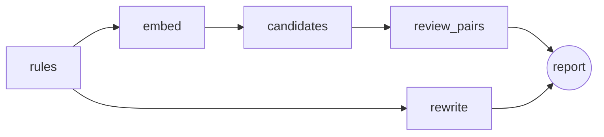

# ReqAgent

**Live demo:** https://reqagent.graybeach-f9d0c697.belgiumcentral.azurecontainerapps.io (scales to zero, so the first request can take up to a minute; LLM runs are limited to 10 per hour per visitor)

ReqAgent reviews natural-language requirements the way a systems engineer would on a first pass. It flags quality problems (vague terms, escape clauses, passive voice and more), and will find duplicates and conflicts with an LLM and export the set as SysML v2.

Status: stage 7 of 7. Rule checks, duplicate and conflict detection, suggested rewrites, SysML v2 export and an evaluation against a labelled set work from the command line, an HTTP API and a web page, packaged as a Docker image and tested on Kubernetes in CI. See [docs/design.md](docs/design.md) for the full plan.

## Try it

```bash
uv sync
cp .env.example .env   # add GROQ_API_KEY (free tier), optionally LANGSMITH_API_KEY
uv run --env-file .env reqagent analyze data/sample/requirements.csv
uv run reqagent analyze data/sample/requirements.csv --rules-only   # no keys needed
uv run --env-file .env reqagent serve    # web page at http://127.0.0.1:8000
```

## HTTP API

| Method | Path | Body / result |
|---|---|---|
| GET | `/` | Web page: paste or upload requirements, see findings, pairs, rewrites, download SysML |
| GET | `/health` | `{"status": "ok"}` |
| POST | `/analyze` | `{"content": "...", "filename": "reqs.csv", "rules_only": false}` → `{"report": {...}, "sysml": "..."}` |

Interactive API docs are at `/docs`. Limits: 200 requirements and 200 kB per request. A missing API key or an embedding model that cannot load returns 503 with the reason; bad input returns 400.

## How it works



- **rules:** deterministic smell checks (table below). Cheap, testable, explainable.
- **embed:** local embedding model (`BAAI/bge-small-en-v1.5` via fastembed), no API key.
- **candidates:** ChromaDB nearest neighbours; only pairs above 0.75 cosine similarity go to the LLM, so cost grows with the number of similar pairs instead of n².
- **review_pairs:** the LLM labels each candidate pair duplicate, conflict or unrelated, with a reason.
- **export:** `model.sysml` holds every requirement as a SysML v2 `requirement` (id as short name, text as `doc`, findings and the suggested rewrite as comments), plus a named `dependency` for each duplicate or conflict.
- **rewrite:** for every requirement with findings, the LLM suggests a fixed version. Missing values become `[TBD: ...]` instead of invented numbers.

The LLM is Groq `openai/gpt-oss-120b` by default (`REQAGENT_LLM=gemini` switches to Gemini). Answers are requested as strict JSON schema output. A client-side rate limiter keeps runs inside the free tiers (default 0.2 requests/s for Groq, set `REQAGENT_RPS` to change it), so the 15-requirement sample takes about a minute and `reqagent eval` a few minutes. A failed LLM call is skipped and listed under `errors` in the report instead of stopping the run. With `LANGSMITH_TRACING=true` every run is traced in LangSmith. The tests use a fake model, so CI never calls an API.

Input is a CSV with `id,text` columns, or a `.txt` file with one requirement per line. The tool writes `report.json`, `report.md` and `model.sysml`.

## Rule checks

| Code | Smell | Example |
|---|---|---|
| VAGUE | Vague or subjective term | "shall respond quickly" |
| ESCAPE | Escape clause | "if possible" |
| OPEN | Open-ended list | "faults, warnings, etc." |
| COMBINATOR | Several requirements in one | "and/or", two "shall"s |
| PASSIVE | Passive voice without an actor | "shall be displayed" |
| NEGATIVE | Negative requirement | "shall not" |
| PRONOUN | Pronoun instead of the noun | "its reading" |
| UNBOUNDED | Unbounded or untestable quantity | "at least" without a number, "minimize" |
| NO_SHALL | No binding modal verb | "should", or no modal at all |

The categories follow the INCOSE *Guide to Writing Requirements*. The word lists are ReqAgent's own.

## Development

```bash
uv run pytest
uv run ruff check . && uv run ruff format --check .
```

## SysML v2 output

```
requirement <'PUMP-1'> PUMP_1 {
    doc /* The pump controller shall stop the pump within 200 ms of a stop command. */
}
dependency PUMP_1_conflicts_with_PUMP_13 from PUMP_1 to PUMP_13 {
    doc /* conflict: ... */
}
```

SysML v2 has no built-in duplicate or conflict relationship, so the label is in the dependency name and its doc comment.

## Evaluation

`eval/labelled.csv` has 101 requirements from 11 domains (braking, infusion pumps, train doors, drones, a web portal, battery management, HVAC, a satellite, an ATM, an industrial robot, general software). Each one is labelled with its smells. `eval/pairs.csv` lists 5 duplicate and 12 conflict pairs. The set deliberately includes smells the word lists miss ("comfortable", "safe", "shall be sent") and text that only looks like a smell ("below the minimum mark", "at least once per second").

```bash
uv run reqagent eval --rules-only                  # rule checks only
uv run --env-file .env reqagent eval --langsmith   # adds LLM pair review and a LangSmith experiment
```

Latest run (Groq `openai/gpt-oss-120b`, 0 failed LLM calls):

| | Precision | Recall |
|---|---|---|
| Rule checks, all smells (micro) | 0.945 | 0.867 |
| Rule checks, PASSIVE | 1.0 | 0.727 |
| Rule checks, VAGUE | 1.0 | 0.824 |
| Rule checks, UNBOUNDED | 0.5 | 0.75 |
| Duplicate and conflict pairs | 0.889 | 0.941 |

Prompt change, measured: the first pair prompt called a conflict "both cannot be satisfied at once", so the model passed "stop within 200 ms" vs "stop within 500 ms" as compatible. Redefining conflict as "different values for the same limit" moved pair precision/recall from 0.938/0.882 to 0.889/0.941: one more real conflict found, one more false alarm.

Embedding prefilter: 16 of 17 gold pairs (0.941) were similar enough to reach the LLM, while only about 35 of the 5,050 possible pairs were sent.

Full table: [eval/results.md](eval/results.md). Most misses are irregular passives ("sent", "shown", "kept") and vague words outside the list. Most false alarms come from "minimum"/"maximum"/"at least" used with a defined reference instead of a number. Those cases are what the LLM rewrite step is for.

## Docker and Kubernetes

```bash
docker build -t reqagent .
docker run --env-file .env -p 8000:8000 reqagent
```

The image bakes in the embedding model and runs with `HF_HUB_OFFLINE=1`, so containers start without network downloads. It runs as a non-root user and has a health check.

```bash
kubectl create secret generic reqagent-secrets --from-env-file=.env
kubectl apply -f deploy/k8s/
kubectl port-forward service/reqagent 8000:80
```

CI (`.github/workflows/ci.yml`) runs three jobs:
1. **test:** lint and tests (fake LLM, no API calls).
2. **kind:** builds the image, starts a throwaway Kubernetes cluster with kind, deploys `deploy/k8s/`, waits for the rollout and calls `/health` and `/analyze`.
3. **publish:** on `main`, pushes the image to `ghcr.io/ydvdeepesh/reqagent` tagged `latest` and with the commit SHA.

## Azure deployment

The app runs on Azure Container Apps (0.5 CPU, 1 GiB, scales to zero, at most one replica). One-time setup, from the repo root in PowerShell after `az login`:

```powershell
.\scripts\azure-setup.ps1
```

The script walks through each step and waits for Enter before running it. It creates a resource group with a Container Apps environment and the app, and stores API keys from `.env` as Container Apps secrets. It also creates a user-assigned managed identity with a federated credential that GitHub Actions on `main` uses through OIDC (no stored password, Contributor on the resource group only). A managed identity is used instead of an Entra app registration because university tenants usually block app registrations for students. Re-running it is safe.

After that, every push to `main` runs the `deploy` job: OIDC login, `az containerapp update` to the new image (tagged with the commit SHA), and a `/health` check against the public URL.

LLM analyses are limited to 10 per hour per caller (`REQAGENT_LLM_RUNS_PER_HOUR`), so a public URL cannot use up the free-tier quota. Rule checks stay unlimited. The caller is identified by the last `X-Forwarded-For` entry, the one the Azure ingress adds, so a forged header does not reset the limit.
