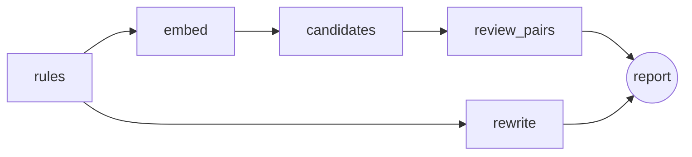

# ReqAgent

ReqAgent reviews natural-language requirements the way a systems engineer would on a first pass. It flags quality problems (vague terms, escape clauses, passive voice and more), and will find duplicates and conflicts with an LLM and export the set as SysML v2.

Status: stage 4 of 7. Rule checks, duplicate and conflict detection, suggested rewrites, SysML v2 export and an evaluation against a labelled set work from the command line. See [docs/design.md](docs/design.md) for the full plan.

## Try it

```bash
uv sync
cp .env.example .env   # add GROQ_API_KEY (free tier), optionally LANGSMITH_API_KEY
uv run --env-file .env reqagent analyze data/sample/requirements.csv
uv run reqagent analyze data/sample/requirements.csv --rules-only   # no keys needed
```

## How it works



- **rules:** deterministic smell checks (table below). Cheap, testable, explainable.
- **embed:** local embedding model (`BAAI/bge-small-en-v1.5` via fastembed), no API key.
- **candidates:** ChromaDB nearest neighbours; only pairs above 0.75 cosine similarity go to the LLM, so cost grows with the number of similar pairs instead of n².
- **review_pairs:** the LLM labels each candidate pair duplicate, conflict or unrelated, with a reason.
- **export:** `model.sysml` holds every requirement as a SysML v2 `requirement` (id as short name, text as `doc`, findings and the suggested rewrite as comments), plus a named `dependency` for each duplicate or conflict.
- **rewrite:** for every requirement with findings, the LLM suggests a fixed version. Missing values become `[TBD: ...]` instead of invented numbers.

The LLM is Groq `openai/gpt-oss-120b` by default (`REQAGENT_LLM=gemini` switches to Gemini). With `LANGSMITH_TRACING=true` every run is traced in LangSmith. The tests use a fake model, so CI never calls an API.

Input is a CSV with `id,text` columns, or a `.txt` file with one requirement per line. The tool writes `report.json`, `report.md` and `model.sysml`.

## Rule checks

| Code | Smell | Example |
|---|---|---|
| VAGUE | Vague or subjective term | "shall respond quickly" |
| ESCAPE | Escape clause | "if possible" |
| OPEN | Open-ended list | "faults, warnings, etc." |
| COMBINATOR | Several requirements in one | "and/or", two "shall"s |
| PASSIVE | Passive voice without an actor | "shall be displayed" |
| NEGATIVE | Negative requirement | "shall not" |
| PRONOUN | Pronoun instead of the noun | "its reading" |
| UNBOUNDED | Unbounded or untestable quantity | "at least" without a number, "minimize" |
| NO_SHALL | No binding modal verb | "should", or no modal at all |

The categories follow the INCOSE *Guide to Writing Requirements*. The word lists are ReqAgent's own.

## Development

```bash
uv run pytest
uv run ruff check . && uv run ruff format --check .
```

## SysML v2 output

```
requirement <'PUMP-1'> PUMP_1 {
    doc /* The pump controller shall stop the pump within 200 ms of a stop command. */
}
dependency PUMP_1_conflicts_with_PUMP_13 from PUMP_1 to PUMP_13 {
    doc /* conflict: ... */
}
```

SysML v2 has no built-in duplicate or conflict relationship, so the label is in the dependency name and its doc comment.

## Evaluation

`eval/labelled.csv` has 101 requirements from 11 domains (braking, infusion pumps, train doors, drones, a web portal, battery management, HVAC, a satellite, an ATM, an industrial robot, general software). Each one is labelled with its smells. `eval/pairs.csv` lists 5 duplicate and 12 conflict pairs. The set deliberately includes smells the word lists miss ("comfortable", "safe", "shall be sent") and text that only looks like a smell ("below the minimum mark", "at least once per second").

```bash
uv run reqagent eval --rules-only                  # rule checks only
uv run --env-file .env reqagent eval --langsmith   # adds LLM pair review and a LangSmith experiment
```

Rule checks, latest run:

| Smell | Precision | Recall |
|---|---|---|
| All smells (micro) | 0.945 | 0.867 |
| PASSIVE | 1.0 | 0.727 |
| VAGUE | 1.0 | 0.824 |
| UNBOUNDED | 0.5 | 0.75 |

Full table: [eval/results.md](eval/results.md). Most misses are irregular passives ("sent", "shown", "kept") and vague words outside the list. Most false alarms come from "minimum"/"maximum"/"at least" used with a defined reference instead of a number. Those cases are what the LLM rewrite step is for.
